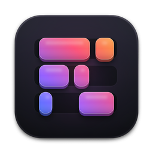
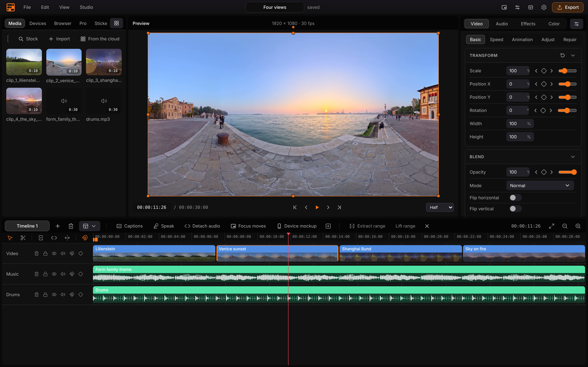
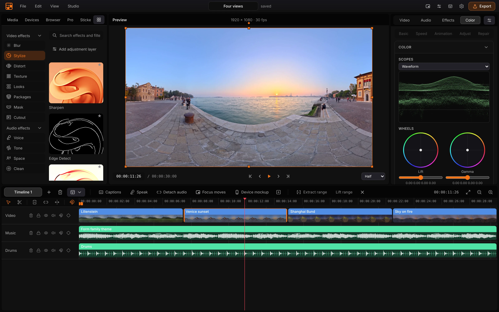
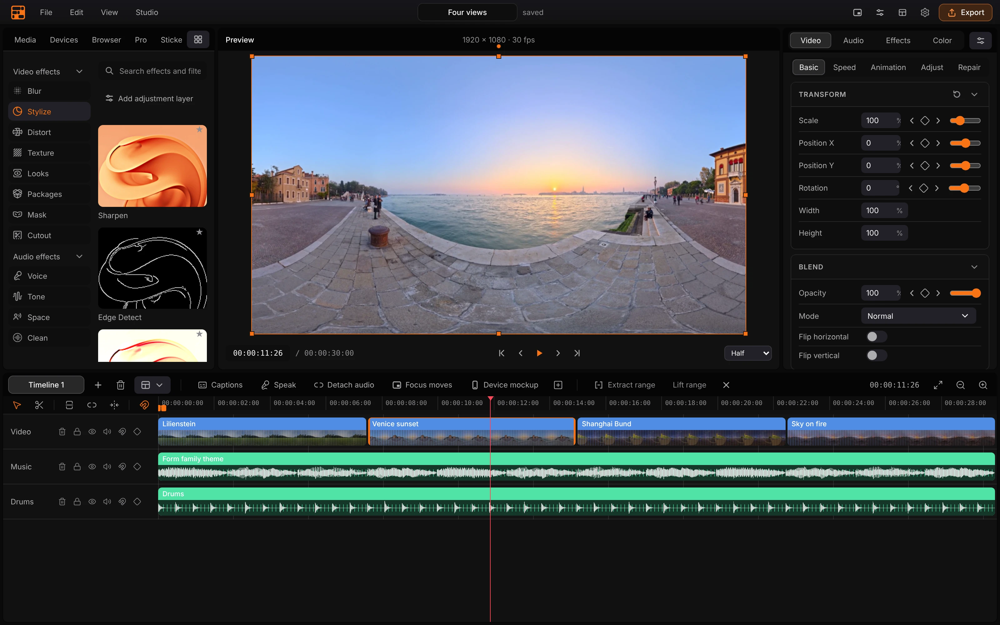
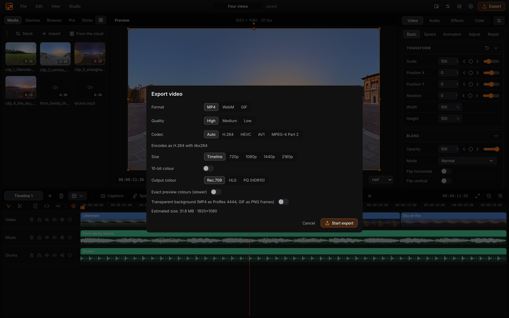

<p align="center">
  
</p>

<h1 align="center">FormCut</h1>

<p align="center">
  <b>Video editing; a local-first multi-track editor with no account and no upload.</b><br>
  Timeline, colour grading, captions, effects and export,<br>
  on your own machine. One renderer for preview and file, and open to agents.
</p>

<p align="center">
  
  
  
  
  
  
</p>

<p align="center">
  <a href="https://formcut.formai.studio/"><b>Download FormCut on formai.studio</b></a> ·
  <a href="#run-it-from-source">Run it from source</a> ·
  <a href="#the-form-family">All Form apps</a>
</p>

<br>

<p align="center">
  
  <br>
  <sub>Four clips and a music track on the timeline, the library on the left, the transform inspector on the right.</sub>
</p>

<p align="center">
  <a href="#features">Features</a> · <a href="#everything-in-the-box">In the box</a> · <a href="#built-for-agents">Agents</a> · <a href="#under-the-hood">Under the hood</a> ·
  <a href="#download">Download</a> · <a href="#run-it-from-source">Run from source</a> · <a href="#the-form-family">Form family</a>
</p>

<br>

<table>
  <tr>
    <td width="25%" valign="top"><h3>What you see is what you get</h3>One renderer draws the preview and the export, so the frame you approve is the frame you ship.</td>
    <td width="25%" valign="top"><h3>Local first</h3>No account, no upload and no telemetry. The engine binds loopback and model downloads are pinned by checksum.</td>
    <td width="25%" valign="top"><h3>A real effect catalogue</h3>Grades, effects, audio chains and transitions, each previewed by the engine, plus packages you can import.</td>
    <td width="25%" valign="top"><h3>Agent-ready</h3>The same editor from the interface, a JSON-RPC surface and an MCP server, so an agent can cut a video.</td>
  </tr>
</table>

<br>

## Features

<table>
  <tr>
    <td width="50%" valign="top">
      
      <br><sub>The Color tab with a waveform scope and grading wheels.</sub>
      <h3>Colour grading with scopes</h3>
      Waveform, parade, vectorscope and histogram, lift, gamma and gain wheels, curves and LUTs. The export bakes the same grade.
    </td>
    <td width="50%" valign="top">
      
      <br><sub>The effects browser, every thumbnail rendered by the engine.</sub>
      <h3>Browsable effects</h3>
      Pick a category and see each effect applied to a real frame before you add it. Adjustment layers apply a stack to everything beneath.
    </td>
  </tr>
  <tr>
    <td width="50%" valign="top">
      
      <br><sub>The export dialog with codec, size and colour choices.</sub>
      <h3>Export you can trust</h3>
      H.264, HEVC, AV1, VP9 and GIF, with hardware encoders preferred and a live size estimate. HDR output tags travel with the file.
    </td>
    <td width="50%" valign="top">
      <h3>Captions, tracking and cutout</h3>
      Whisper captions from a local model, motion and planar tracking, and background removal that works out of the box.
    </td>
  </tr>
</table>

## Everything in the box

<table>
  <tr>
    <td width="33%" valign="top"><h4>76 video effects</h4>Blur · Stylize · Distort · Texture · Looks · Masks · Cutout · 74 colour grades · 23 transitions</td>
    <td width="33%" valign="top"><h4>48 audio chains</h4>Voice · Tone · Space · Clean · loudness target and true-peak ceiling on export</td>
    <td width="33%" valign="top"><h4>Formats</h4>Opens: video, audio, HEIC, HEIF, AVIF, TIFF, SRT, WebVTT · Saves: MP4, WebM, GIF · Native: <code>.fc</code></td>
  </tr>
</table>

## Built for agents

FormCut ships an MCP server with 32 workflow tools; the interface, the JSON-RPC surface and the MCP server edit the same project.

```sh
./formcut mcp            # MCP server on stdio, starts the engine if nothing answers
./formcut claude         # Claude Code here, already connected to the formcut tools
./formcut agents status  # show how Claude Code, Codex and Cursor are set up
```

`.mcp.json`, `.codex/config.toml` and `.cursor/mcp.json` are already wired in this repo. See [`AGENTS.md`](AGENTS.md).

## Under the hood

- **One renderer:** decode, effects, masks, grade and composite share one path for the canvas and the file, held together by a golden-frame check in CI.
- **Engine:** Python and FastAPI over FFmpeg's libraries, with WGSL device passes for effects and the CPU path kept as the reference.
- **Interface:** vanilla TypeScript and Vite on one CSS token system, no UI framework and no icon dependency, in 16 languages.
- **Automation:** JSON-RPC 2.0 over HTTP, websocket, stdin, TCP and gRPC, with optimistic concurrency on every edit.
- **Tested:** 868 Python test functions under `tests/` plus a window test in `frontend/tests/`, run in CI on every push.

## Download

**Get the app:** download FormCut from [formai.studio](https://formcut.formai.studio/). That is the easiest way to install it.

**Latest builds:** see the [FormCompiler releases](https://github.com/nodemode-dev/formcompiler/releases?q=formcut-v&expanded=true). **Keep it updated:** [FormPortal](https://github.com/nodemode-dev/formportal) installs, updates and rolls back every Form app from the same signed catalogue.

Builds exist for macOS (Apple silicon), Windows (x64) and Linux (x64). All FormCut builds are compiled and released from [`nodemode-dev/formcompiler`](https://github.com/nodemode-dev/formcompiler/releases), not from this repo. This repo holds the source.

## Run it from source

Prefer it in your browser, or want to contribute? Run the web UI straight from this repo.

**Requires:** Node 18+, Python 3.11+, and `ffmpeg` and `ffprobe` on PATH.

```sh
git clone git@github.com:nodemode-dev/formcut.git
cd formcut
chmod +x formcut
./formcut           # installs the engine and the interface on first run, then boots both
```

The interface opens at http://localhost:3040. On first run `.env` is created from `example.env`; every key in it is optional.

On Windows run `formcut.bat`. The engine listens on http://127.0.0.1:8040; `FORMCUT_DATA_DIR`, `FORMCUT_MODELS_DIR` and `FORMCUT_PORT` in `.env` move its data, models and port.

> [!IMPORTANT]
> **Status:** active development. The Android and iOS apps are companions that pair with FormCut running on a computer, and have not been tested on real devices yet.

**Contributing:** branch from `main`, keep changes to source here, and leave packaging and releases to formcompiler. See [`CONTRIBUTING.md`](CONTRIBUTING.md) and [`AGENTS.md`](AGENTS.md).

## Repository

| Path | What it is |
|---|---|
| `frontend/` | Vanilla TypeScript and Vite interface |
| `backend/` | Python FastAPI engine, renderer and MCP server |
| `src-tauri/` | Tauri 2 desktop shell |
| `setup/` | Install, boot and build scripts |

Docs: [`.docs/wiki`](.docs/wiki/Home.md) · Agents: [`CLAUDE.md`](CLAUDE.md), [`AGENTS.md`](AGENTS.md) · Contributing: [`CONTRIBUTING.md`](CONTRIBUTING.md)

## The Form family

FormCut is one of the **Form apps**: native creative tools that install, update and roll back through FormPortal and can all be driven by agents.

| | App | What it's for | Download | Code |
|:-:|---|---|---|---|
|  | **form.md** | Documents, databases and realtime editing together | [formai.studio](https://formmd.formai.studio/) | [GitHub](https://github.com/nodemode-dev/form.md) |
|  | **FormAT** | Chat and agent workspace on your key | [formai.studio](https://format.formai.studio/) | [GitHub](https://github.com/nodemode-dev/format) |
|  | **FormCAD** | Drafting, parametric parts and NURBS surfaces | | [GitHub](https://github.com/nodemode-dev/formCAD) |
|  | **FormCel** | Spreadsheets agents can read and edit | [formai.studio](https://formcel.formai.studio/) | [GitHub](https://github.com/nodemode-dev/formcel) |
|  | **FormCraft** | Generate images, video, audio, 3D and worlds | | [GitHub](https://github.com/nodemode-dev/formcraft) |
|  | **FormCut** | Multi-track video editing with no upload | [formai.studio](https://formcut.formai.studio/) | [GitHub](https://github.com/nodemode-dev/formcut) |
|  | **FormDAM** | Photo library and asset manager | [formai.studio](https://formdam.formai.studio/) | [GitHub](https://github.com/nodemode-dev/formDAM) |
|  | **FormDeck** | Presentations and pitch decks | [formai.studio](https://formdeck.formai.studio/) | [GitHub](https://github.com/nodemode-dev/formdeck) |
|  | **FormDesign** | Page layout for print and the web | [formai.studio](https://formdesign.formai.studio/) | [GitHub](https://github.com/nodemode-dev/formdesign) |
|  | **FormEncoder** | Media encoding queue with presets | [formai.studio](https://formencoder.formai.studio/) | [GitHub](https://github.com/nodemode-dev/formencoder) |
|  | **FormFabric** | Sewing patterns draped with cloth simulation | | [GitHub](https://github.com/nodemode-dev/formfabric) |
|  | **FormLit** | Photo library and raw development | [formai.studio](https://formlit.formai.studio/) | [GitHub](https://github.com/nodemode-dev/formlit) |
|  | **FormMorpheus** | Frame-by-frame and performed animation | | [GitHub](https://github.com/nodemode-dev/formmorpheus) |
|  | **FormNET** | See what your computer sends online | | [GitHub](https://github.com/nodemode-dev/formNET) |
|  | **FormPath** | Vector illustration with artboards and type | [formai.studio](https://formpath.formai.studio/) | [GitHub](https://github.com/nodemode-dev/formpath) |
|  | **FormPDF** | Edit, redact, sign and fill PDFs | [formai.studio](https://formpdf.formai.studio/) | [GitHub](https://github.com/nodemode-dev/formpdf) |
|  | **FormPromo** | Promo films from your own media | [formai.studio](https://formpromo.formai.studio/) | [GitHub](https://github.com/nodemode-dev/formpromo) |
|  | **FormRef** | Reference boards for creative work | [formai.studio](https://formref.formai.studio/) | [GitHub](https://github.com/nodemode-dev/formref) |
|  | **FormRig** | Rig, skin and retarget any mesh | | [GitHub](https://github.com/nodemode-dev/formrig) |
|  | **FormSculpt** | 3D sculpting, remeshing and painting | [formai.studio](https://formsculpt.formai.studio/) | [GitHub](https://github.com/nodemode-dev/formsculpt) |
|  | **FormSurface** | Texture painting with PBR export | [formai.studio](https://formsurface.formai.studio/) | [GitHub](https://github.com/nodemode-dev/formsurface) |
|  | **FormTools** | Viewers, batch tools and file utilities | | [GitHub](https://github.com/nodemode-dev/formtools) |
|  | **FormTxt** | Word processing with .docx round trips | [formai.studio](https://formtxt.formai.studio/) | [GitHub](https://github.com/nodemode-dev/formtxt) |
|  | **FormVFX** | Motion graphics and VFX compositing | [formai.studio](https://formvfx.formai.studio/) | [GitHub](https://github.com/nodemode-dev/formvfx) |
|  | **FormVis** | Layered image editing with local AI | [formai.studio](https://formvis.formai.studio/) | [GitHub](https://github.com/nodemode-dev/formvis) |
|  | **FormWav** | Multitrack audio editing and mixing | [formai.studio](https://formwav.formai.studio/) | [GitHub](https://github.com/nodemode-dev/formwav) |
|  | **FormWeb** | Visual website building with a CMS | [formai.studio](https://formweb.formai.studio/) | [GitHub](https://github.com/nodemode-dev/formweb) |
|  | **FormPortal** | Install, update and roll back Form apps | [formai.studio](https://formportal.formai.studio/) | [GitHub](https://github.com/nodemode-dev/formportal) |
|  | **FormTray** | One dock icon for every app | [formai.studio](https://formtray.formai.studio/) | [GitHub](https://github.com/nodemode-dev/formtray) |
|  | **FormMCP** | One MCP connection to the family | [formai.studio](https://formmcp.formai.studio/) | [GitHub](https://github.com/nodemode-dev/formMCP) |
|  | **FormSkills** | Every app's agent skills in one place | [formai.studio](https://formskill.formai.studio/) | [GitHub](https://github.com/nodemode-dev/formskills) |
|  | **FormBench** | Parity, testing and rankings for the family | [formai.studio](https://formranker.formai.studio/) | [GitHub](https://github.com/nodemode-dev/formbench) |
|  | **FormSlot** | Codebase memory for coding agents | | [GitHub](https://github.com/nodemode-dev/formslot) |
|  | **SubForm** | Workbench for parallel Claude Code agents | | [GitHub](https://github.com/nodemode-dev/subform) |
|  | **FormCompiler** | Builds, signs and releases every app | [formai.studio](https://formcompiler.formai.studio/) | [GitHub](https://github.com/nodemode-dev/formcompiler) |
|  | **FormPipe** | Release pipeline and update feeds | | [GitHub](https://github.com/nodemode-dev/formpipe) |

<br>

---

## Maintainers

| Maintainer | Role |
|---|---|
| [@nodemode-ai](https://github.com/nodemode-ai) | Owner |
| [@gbarnai](https://github.com/gbarnai) | Co-owner |

Code owners are set in [`.github/CODEOWNERS`](.github/CODEOWNERS).

## License

FormCut is licensed under the Apache License 2.0 ([`LICENSE`](LICENSE), SPDX `Apache-2.0`). Copyright 2026 NodeAgentc, Inc. Third-party notices: [`NOTICE`](NOTICE). How FormCut may be used is set out in [`USE_POLICY.md`](USE_POLICY.md).

<sub>Screenshot content: CC0 panoramic video clips made from Poly Haven photos, and music made for the Form family.</sub>

